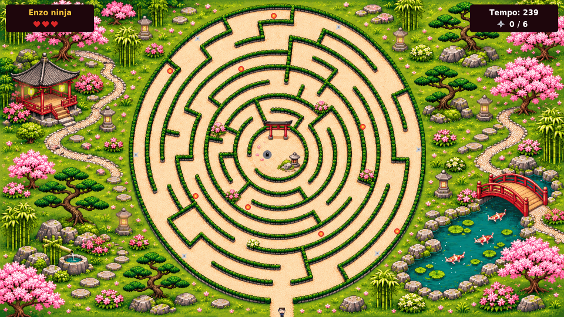
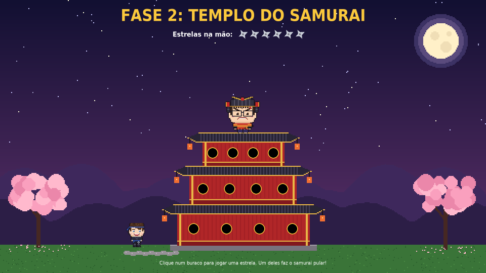
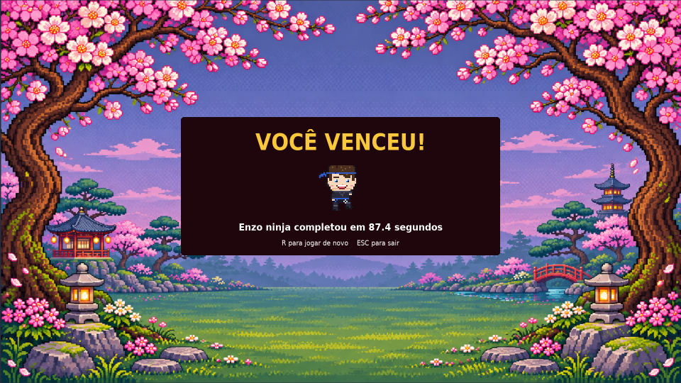

#  Resina Strikes Back

Um jogo de ação e sorte em pixel art, feito em Python com Pygame: escolha seu ninja, atravesse um labirinto em chamas e enfrente o samurai Resina no topo do templo.


# 🎬 Vídeo do jogo

▶️ **Assista ao jogo funcionando:** [Resina Strikes Back – Jogo Pygame](https://youtu.be/fPYB7uB1CGw)

---

# Sobre o projeto

O jogo tem duas fases, inspiradas em jogos de labirinto e no brinquedo 'Pula Pirata', da Estrela:

1. O Labirinto do Jardim: um labirinto animado onde você coleta 6 estrelas ninja, desvia de bolas de fogo e corre até o gongo no centro, tudo isso em até 4 minutos.
2. O Templo do Samurai: o samurai Resina está no telhado do templo. Você precisa jogar suas 6 estrelas nos 12 buracos do templo, mas um deles é uma armadilha sorteada a cada partida. Acertou nele? BOING! O samurai pula e você perde.

Vença as duas fases e o jogo mostra quanto tempo você levou.

# Funcionalidades

- 3 personagens jogáveis (Enzo ninja, Lucas ninja e Resina samurai), cada um com animações de parado, andando e correndo.
- Fundo animado no labirinto, com 8 quadros que se alternam.
- Colisão com as paredes por mapa de cores: uma imagem separada (`mapa_colisao.png`) diz onde o personagem pode andar, então o desenho do labirinto pode ser tão detalhado quanto quisermos.
- Bolas de fogo com velocidades diferentes: cada uma é um pouco mais rápida que a anterior e escolhe sozinha entre 8 direções.
- Sistema de vidas (3 corações), cronômetro e contador de estrelas na tela.
- Armadilha sorteada na fase 2: cada partida é diferente.
- Música de fundo e efeitos sonoros para estrela, dano, pulo, vitória e erro.
- Tela de vitória e de game over, com opção de jogar de novo.

# O que aprendemos

- Organizar um jogo em telas (estados): escolha → labirinto → templo → vitória/game over, cada uma num arquivo e cada uma devolvendo qual é a próxima tela.
- Usar sprites e grupos do Pygame (`pygame.sprite.Sprite`, `Group`, `spritecollide`) para desenhar e testar colisões.
- Separar configuração (`config.py`), carregamento de arquivos (`assets.py`) e desenho (`desenho.py`) da lógica do jogo, para ajustar números sem mexer no resto do código.
- Trabalhar em grupo no e GitHub: commits e resolver conflitos quando mais de uma pessoa está mexendo no projeto ao mesmo tempo.

# Desafios

- Indentação em Python: um bloco com 4 espaços a mais deixou o labirinto congelado, porque o loop do jogo foi parar dentro de outro `for`. Aprendemos a olhar com cuidado o alinhamento dos blocos e cada detalhe, para não cometer nenhum erro.
- Colisão com um labirinto : em vez de montar as paredes com retângulos, criamos uma imagem de colisão e testamos a cor do pixel onde o personagem quer ir.
- Mesmo tamanho em qualquer tela: o jogo é desenhado sempre em 1920×1080, e o modo `SCALED` do Pygame adapta para a tela de cada computador.

# Próximos passos

- Mais fases e novos inimigos.
- Ranking com os melhores tempos.
- Níveis de dificuldade (mais bolas de fogo, menos tempo).

# Sumário

- [Como instalar e rodar](#-como-instalar-e-rodar)
- [Como jogar](#-como-jogar)
- [Estrutura do projeto](#-estrutura-do-projeto)
- [Créditos](#-créditos)
- [Licença](#-licença)

---

# Como instalar e rodar

### Pré-requisitos

- [Python 3](https://www.python.org/downloads/) (testado com Python 3.14)
- [Git](https://git-scm.com/) (opcional, para clonar o repositório)

# Passo a passo

1. Clone o repositório
   ```bash
   git clone https://github.com/manuelalmbreval/Jogo_ninja_manus_carol.git
   cd Jogo_ninja_manus_carol
   ```

2. (Opcional) Crie um ambiente virtual
   ```bash
   python3 -m venv .venv
   source .venv/bin/activate      # macOS / Linux
   .venv\Scripts\activate         # Windows
   ```

3. Instale o Pygame
   ```bash
   pip install pygame-ce
   ```
   > O projeto usa o **pygame-ce** (Community Edition), mas também funciona com o `pygame` tradicional. Instale só um dos dois.

4. Rode o jogo
   ```bash
   python3 jogo.py
   ```
   O jogo abre em **tela cheia**. Para sair a qualquer momento, aperte **ESC**.

# Como jogar

# Controles

| Tela | Tecla / Ação | O que faz |
|------|--------------|-----------|
| Capa | `Espaço` | Começa o jogo |
| Escolha | `1`, `2` ou `3` | Escolhe Enzo, Lucas ou Resina |
| Labirinto | `←` `↑` `→` `↓` | Move o personagem |
| Labirinto | `Shift` (segurando) | Corre |
| Templo | Clique do mouse num buraco | Joga uma estrela |
| Fim de jogo | `R` | Joga de novo |
| Qualquer tela | `ESC` | Sai do jogo |

# Fase 1: O Labirinto



- Pegue as 6 estrelas ninja espalhadas pelo labirinto.
- Fuja das bolas de fogo: cada toque tira 1 vida e manda você de volta para a entrada.
- Com todas as estrelas, o gongo no centro se abre. Chegue nele para passar de fase.
- Você perde se acabarem as 3 vidas ou os 4 minutos.

# Fase 2: O Templo do Samurai



- Você tem 6 estrelas e o templo tem 12 buracos.
- Passe o mouse por cima de um buraco para destacá-lo e clique para jogar a estrela.
- Um dos buracos é a armadilha. Se a estrela cair nele, o samurai pula e é game over.
- Jogue as 6 estrelas sem acertar a armadilha para vencer!

# Vitória



---

# Estrutura do projeto


```
Jogo_ninja_manus_carol/
├── jogo.py              # Arquivo principal: abre a janela e troca entre as telas
├── config.py            # Todos os números do jogo: tamanhos, cores, tempos, posições
├── assets.py            # Carrega imagens, sons e fontes
├── sprites.py           # Personagens, bolas de fogo, estrelas, gongo, buracos e samurai
├── desenho.py           # Funções para escrever textos e desenhar painéis, corações e estrelas
├── tela_escolha.py      # Tela 1: escolha do personagem
├── tela_labirinto.py    # Fase 1: o labirinto
├── tela_templo.py       # Fase 2: o templo do samurai
├── tela_final.py        # Tela de vitória ou game over
├── imagens/
│   ├── enzo/  lucas/  resina/   # Animações de cada personagem
│   ├── resina_caretas/          # Expressões do samurai
│   ├── labirinto/               # Quadros do fundo animado + mapa de colisão
│   ├── fase2/                   # Fundo do templo
│   └── fundo.png                # Jardim das telas de escolha e fim
├── sons/                # Música e efeitos sonoros (.wav)
└── docs/                # Capturas de tela usadas neste README
```

---

# Créditos

Projeto feito por:

| | Nome | GitHub |
|---|------|--------|
| 🥷 | **Carolina Bosco Ferreira** | [@carolinabf4](https://github.com/carolinabf4) |
| 🥷 | **Manuela Lobo Moutinho Breval** | [@manuelalmbreval](https://github.com/manuelalmbreval) |
| 🥷 | **Manuela Sousa Barbosa** | [@manuabarb](https://github.com/manuabarb) |

# Ferramentas e referências

- [Pygame Community Edition](https://pyga.me/): biblioteca usada para fazer o jogo
- [Documentação do Pygame](https://www.pygame.org/docs/)
- Jogabilidade da fase 2 inspirada no brinquedo Pula Pirata da Estrela.

---

# Licença

Este é um projeto acadêmico e ainda não tem uma licença definida.

Resina Strikes Back - Jogo Pygame: https://youtu.be/fPYB7uB1CGw
